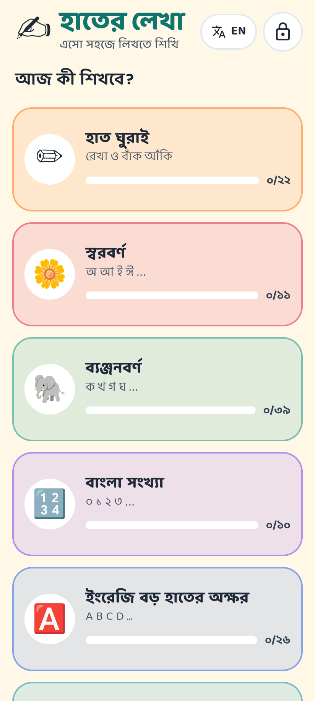
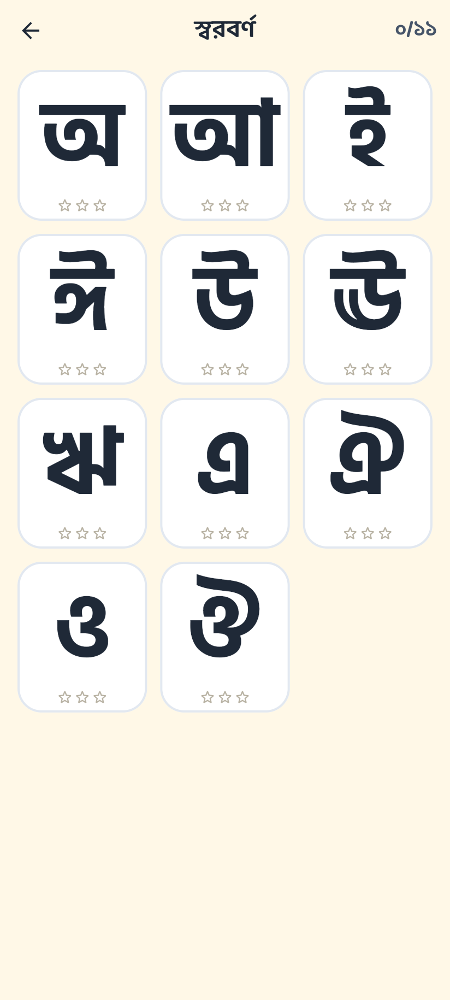
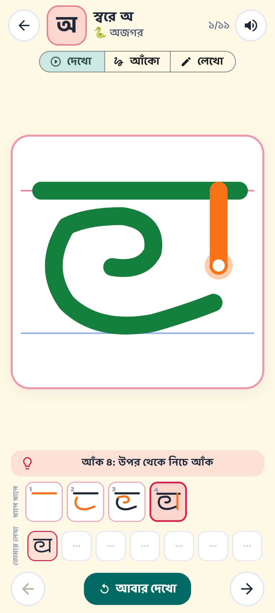
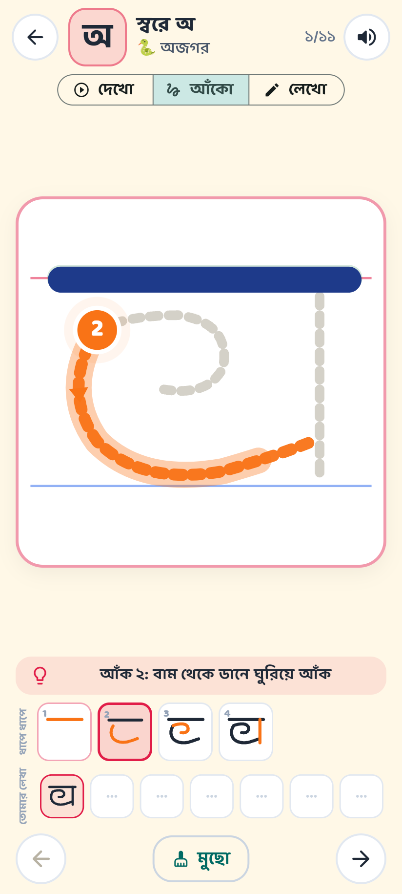
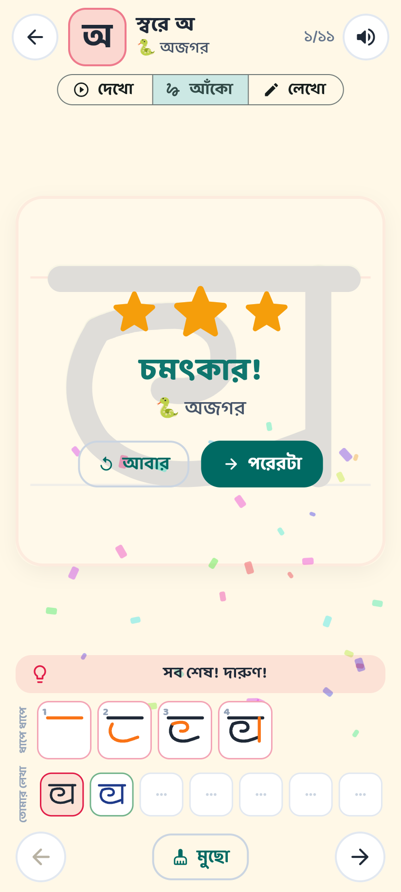

# হাতের লেখা · Hater Lekha

A Flutter handwriting-practice app for pre-primary children (ages 4–6) that
teaches **Bengali letters, English letters and numbers** the way a classic
Bangladeshi copybook does — *হাত ঘুরাই → দেখি → বিন্দুর উপর আঁকি → নিজে লিখি*
(warm-up strokes → watch → trace the dots → write it yourself).

The curriculum and page structure follow the workbook *এসো সহজে লিখতে শিখি –
হাতের লেখা শেখার পদ্ধতি (বাংলা, ইংরেজি ও অঙ্ক)*: a page of pre-writing stroke
drills with direction labels, then one row per letter showing the letter built
up stroke by stroke, dotted letters to trace, and empty cells to fill in.

## Screenshots

| Home | Letter grid | Watch | Trace | Reward |
| --- | --- | --- | --- | --- |
|  |  |  |  |  |

Captured from the web build in a 412×915 viewport; the practice screen also has a landscape layout (`docs/screenshots/landscape.png`).

## What the app does

| Section | Content |
| --- | --- |
| হাত ঘুরাই (pre-writing) | 22 stroke drills: top→bottom, bottom→top, left→right, slants, angles, arches, cups, circles both ways, waves, zig-zags, loops |
| স্বরবর্ণ | 11 vowels অ–ঔ |
| ব্যঞ্জনবর্ণ | 39 consonants ক–ঁ (incl. ড় ঢ় য় ৎ ং ঃ ঁ) |
| বাংলা সংখ্যা | ০–৯ |
| English | A–Z, a–z, 0–9 |

Every glyph has three pages, mirroring the copybook row:

1. **দেখো / Watch** – an animated finger draws the letter stroke by stroke, with
   the stroke number and a direction hint ("উপর থেকে নিচে আঁক"). A
   "step by step" strip shows the letter growing one stroke at a time.
2. **আঁকো / Trace** – dotted guide, a pulsing numbered start dot and a direction
   arrow. The tracing engine insists on the right stroke order and direction,
   nudges when the finger wanders, and awards 1–3 stars for accuracy.
3. **লেখো / Write** – just the ruled lines. The child writes freely; strokes
   that match the model are credited silently, and the attempt lands in the
   "your writing" row, exactly like filling the blank cells in the book.

Also: Bengali letter names spoken aloud (স্বরে অ, হ্রস্ব ই, মূর্ধন্য ণ …) and an
example word with an emoji for each letter, star rewards with confetti,
progress saved on device, a parent area (behind a small arithmetic gate) with
a per-letter report and settings (language বাংলা/English, difficulty,
voice, sounds, left-handed layout, reset).

## Design decisions

* **Flutter 3.47 / Dart 3.13, Material 3.** One codebase for Android, iOS, web
  and desktop. Tested here with `flutter test` and a release web build.
* **Stroke data is hand-authored, not font-derived.** Each glyph is a list of
  SVG paths in a 100×100 box (`assets/data/glyphs.json`), written in the
  order and direction a teacher would draw them. Shapes were authored against
  the outlines of the Hind Siliguri font and checked visually
  (`tool/author_glyphs.py` generates the JSON; `tool/preview_sheet.js`
  renders a contact sheet with Playwright). Changing a letter means editing
  one path string and regenerating.
* **Custom tracing engine** (`lib/engine/`) – pure Dart, unit-tested. Paths are
  sampled every unit of arc length; a finger must start near the stroke start,
  is matched against a look-ahead window (so circles can't be "finished" at
  the first touch), and must cover ≥ 88 % of the stroke (difficulty-dependent).
  Dots (ড় ঢ় য় র, i, j) are tap targets.
* **Riverpod 3** for state, **shared_preferences** for persistence (progress
  only ever increases), **path_drawing** for SVG parsing and dashed guides,
  **flutter_tts** for voice (best-effort; devices without a Bengali voice stay
  silent rather than erroring).
* **Fonts bundled, no runtime downloads:** Baloo Da 2 (friendly rounded
  Bengali+Latin, UI) and Hind Siliguri (clean letter models). Both SIL OFL;
  licences in `assets/fonts/`.
* **Kid-first UI:** large touch targets, paper palette, no ads, no network,
  landscape and portrait layouts, left-handed option.

## Build & run

```bash
flutter pub get
flutter run --flavor dev                    # device / emulator (Android needs a flavor)
flutter run -d chrome                       # web
flutter build apk --release --flavor prod   # Android
flutter test && flutter analyze             # checks
```

### Android flavors, Firebase and test builds

| Flavor | Package | Label | Firebase app id |
|---|---|---|---|
| `prod` | `com.haterlekha.hater_lekha` | হাতের লেখা | `1:890856229289:android:9c58d3529781a772fd5cb8` |
| `dev` | `com.haterlekha.hater_lekha.dev` | DEV হাতের লেখা | `1:890856229289:android:d910622e843c4475fd5cb8` |

- Firebase project **`hater-lekha-app`** (owner `anwarcs36@gmail.com`), Crashlytics + Analytics on
  Android only. One `android/app/google-services.json` holds both clients; the Gradle plugin picks
  the one matching the flavor. `firebase login:use anwarcs36@gmail.com` once in this directory.
- Both flavors install side by side; `dev` has a red DEV band on its icon
  (`android/app/src/dev/res`).
- Release signing reads `android/key.properties` (git-ignored) pointing at
  `android/keystore/hater-lekha-keystore.jks` (git-ignored). Debug builds use the same key so a
  local run and a test build replace each other. **Back the keystore up** — without it testers must
  uninstall before the next update. CI has neither file and falls back to the debug key.
- Test builds go to Firebase App Distribution, tester group alias `sofworks-testers`:

```bash
./release_script.sh dev     # bump patch + dev counter, test, build, upload dev flavor
./release_script.sh prod    # bump patch + build number, test, build, upload prod flavor
```

  Edit `release_note.txt` first (testers see it as "What's new"). Every build is also kept in
  `build/releases/`. Add testers with
  `firebase appdistribution:testers:add a@b.com --group-alias sofworks-testers --project hater-lekha-app`;
  they accept the e-mail invite and install builds through the Firebase App Tester app.

Regenerate glyph data after editing `tool/author_glyphs.py`:

```bash
python3 tool/author_glyphs.py assets/data/glyphs.json /tmp/overlay.json
```

## Project layout

```
lib/
  core/        theme, bilingual strings, speech/haptics
  data/        models, glyph repository, settings & progress stores
  engine/      stroke sampling + tracing state machine (unit tested)
  features/    home, category grid, practice (watch/trace/write), parent area
  widgets/     painters (copybook, strokes, ink), shared widgets
assets/data/glyphs.json   all stroke data (generated)
tool/                     glyph authoring & preview tools
```

## Licence notes

App code: MIT (see `LICENSE`). Fonts: SIL Open Font License 1.1. The letter
forms are the standard Bengali and Latin scripts; no artwork from the
workbook is used.
